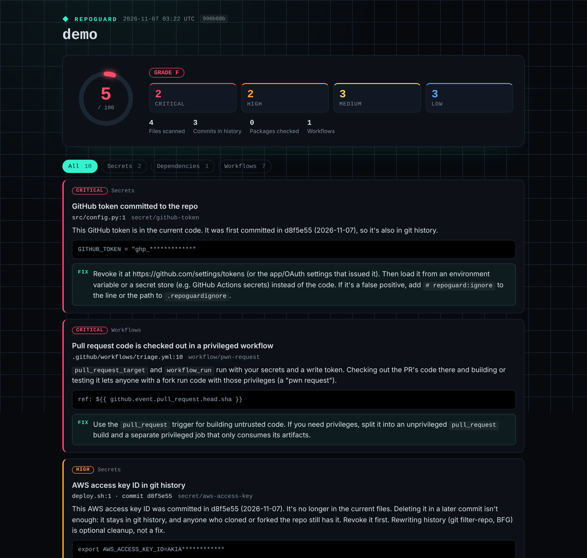

# 🛡️ RepoGuard

A security audit for GitHub repositories. Point it at a repo and get a score out of 100, with every problem explained and a concrete fix.


<sub>Report for a deliberately vulnerable demo repo (fake credentials).</sub>

## What it checks

### 🔑 Leaked secrets, including git history
GitHub, AWS, Stripe, Slack, Google, OpenAI, Anthropic, Notion and Telegram tokens, private keys, database URLs with passwords, and hard-coded passwords (entropy-checked to avoid noise).

It also scans **every commit in history**. A key deleted in a later commit is still in the repo, and anyone who cloned it has it. RepoGuard tells you which commit introduced it.

Secrets are always masked in reports (`ghp_************`).

### 📦 Vulnerable dependencies
Reads `requirements*.txt`, `package-lock.json`, `package.json`, `poetry.lock` and `Pipfile.lock`, and checks every exact version against the [OSV.dev](https://osv.dev) vulnerability database. Duplicate advisories (GHSA / PYSEC / CVE aliases) are merged, severity comes from the advisory or its CVSS v3 vector, and it tells you the lowest version that fixes all of them. It also flags unpinned dependencies.

### ⚙️ Risky GitHub Actions workflows
| Check | Why it matters |
|---|---|
| Actions not pinned to a commit SHA | Tags can be moved to malicious code (the 2025 tj-actions/changed-files compromise) |
| Script injection | `${{ github.event.issue.title }}` in a `run:` step lets anyone who opens an issue run code |
| "Pwn requests" | Checking out PR code in `pull_request_target` gives forks your secrets |
| Missing / `write-all` permissions | Over-privileged `GITHUB_TOKEN` |
| Secrets printed in logs | Masking breaks when values are transformed |
| `persist-credentials` | Checkout leaves the token in `.git/config` |

## Use it as a GitHub Action

```yaml
name: RepoGuard
on:
  push:
    branches: [main]
  pull_request:

permissions:
  contents: read
  pull-requests: write        # for the PR comment

jobs:
  scan:
    runs-on: ubuntu-latest
    steps:
      - uses: actions/checkout@v6
        with:
          fetch-depth: 0             # full history for the secret scan
          persist-credentials: false
      - uses: ollivanter/repoguard@main
        with:
          fail-on: high              # never | low | medium | high | critical
```

Each run writes the report to the **job summary**, keeps **one comment on the pull request** up to date, and uploads the **HTML dashboard** as an artifact. Outputs: `score` and `grade`.

Pin `ollivanter/repoguard` to a commit SHA in real use. RepoGuard will remind you if you don't. 😉

## Use it from the command line

```bash
pip install git+https://github.com/ollivanter/repoguard
repoguard scan .                                   # current folder
repoguard scan ollivanter/life-automations         # any public GitHub repo
repoguard scan . --html report.html --json report.json --markdown report.md
repoguard scan . --fail-on high                    # exit code 1 for CI
```

| Option | |
|---|---|
| `--only secrets\|dependencies\|workflows` | Run selected scanners (repeatable) |
| `--no-history` / `--max-commits N` | Skip or limit the history scan (default 1000 commits) |
| `--offline` | Skip the OSV.dev lookup |
| `--format terminal\|json\|markdown\|html` | What to print |

**False positives:** add `# repoguard:ignore` to the line, or list paths in `.repoguardignore` (one glob per line).

## Scoring

Each issue costs points by severity: critical 25, high 12, medium 5, low 2. Repeats of the same issue cost less each time (`weight × (1 + log₂ n)`), so twenty unpinned actions don't outweigh one leaked key. Any critical issue caps the score at 59 (grade F).

| Grade | A | B | C | D | F |
|---|---|---|---|---|---|
| Score | 90+ | 80+ | 70+ | 60+ | <60 |

## How it works

```
repoguard/
├── secrets.py     regex rules + entropy, git log -p history scan, masking
├── deps.py        manifest parsers, OSV.dev batch client, alias merging, fix versions
├── cvss.py        CVSS v3.1 base score calculator
├── workflows.py   YAML loader with line numbers, Actions rules
├── scoring.py     score and grade
├── report.py      terminal, JSON, Markdown and HTML dashboard
└── ghcomment.py   sticky PR comment
```

Only depends on `requests`, `PyYAML` and `packaging`. 79 tests run offline against fake OSV and GitHub APIs, and CI also runs live tests against the real OSV.dev API:

```bash
pip install ".[test]" && pytest
```

RepoGuard scans itself on every push (see `.github/workflows/repoguard.yml`), and its own workflows pin every action to a SHA.

## Licence

MIT
